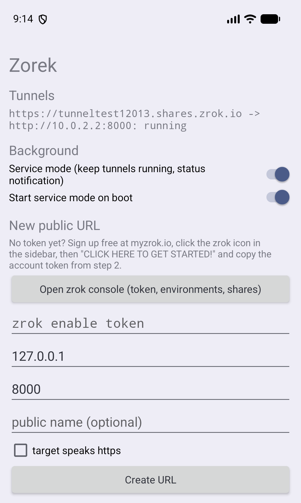
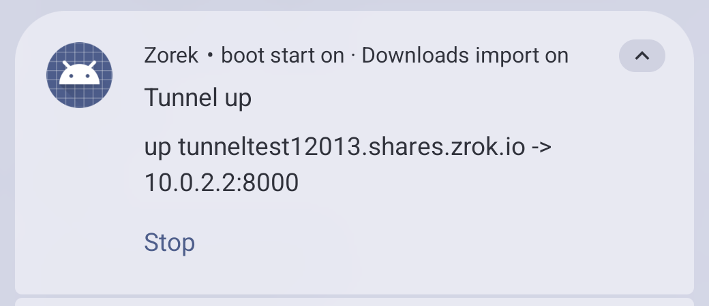

# Android app

Package `com.rel.zorek`. The same Python backend as the PC app runs inside the app (through
[Chaquopy](https://chaquo.com/chaquopy/)), next to `libziti.so`, the native zrok/ziti library built with the NDK.

| | |
|---|---|
| minSdk | 28 (Android 9) |
| ABIs | `arm64-v8a`, `armeabi-v7a`, `x86_64` (emulator) |
| Install | sideload the APK from the [releases page](https://github.com/mon231/com.rel.zorek/releases) |

## Screen

{ width=300 align=right }

The single screen has five parts, top to bottom:

1. **Tunnels**: one line per share, `public-url -> target: state`. State is `running`, `connecting` (the identity is
   still loading) or the last error. Refreshed every 2 seconds.
2. **Background**: the *Service mode* and *Start service mode on boot* switches. See below.
3. **New public URL**: a reminder of how to get the enable token, the **Open zrok console** button, the token field,
   target IP, target port, optional public name, *target speaks https* and **Create URL**. See
   [Get a zrok account and token](getting-started.md) and [Creating URLs](creating-urls.md). The new URL is copied to
   the clipboard.
4. **Folder import**: the *Import shares_\*.json from Downloads* switch. See below.
5. **Config (shares.json)**: the raw config in an editor, with **Save config**. It shows the whole config, including
   the private key, so mind screen sharing.

## Service mode

Service mode is a **flag** (on by default). When it is on, the tunnels are served by a foreground service that

- keeps running when you leave the app or swipe it away from the recents list,
- is restarted by the system if it is killed (`START_STICKY`),
- shows a permanent, informative notification (next section).

When it is off there is no service and no notification: the tunnels run only while the app process is alive, which in
practice means while you use the app.

### The notification



| Part | Meaning |
|------|---------|
| Title | `Tunnel up`, `All 3 tunnels up`, `2 of 3 tunnels up`, or `No tunnels configured`. |
| Line / expanded text | One line per tunnel: `up` / `...` (connecting) / `DOWN`, the public host, the target `ip:port`, and for a problem the reason in brackets. A config or import error is shown first, prefixed with `!`. |
| Small text | The state of the flags: `boot start on/off`, `Downloads import on/off`. |
| Tap | Opens the app. |
| **Stop** button | Stops all tunnels, removes the notification, and turns *service mode* and *start on boot* **off**. Turn service mode on again in the app to resume. |

The notification updates every 3 seconds, but only re-posts when something changed, so it does not buzz or flicker. It
is low priority: no sound, no heads-up.

!!! tip "Allow notifications"
    On Android 13+ the system asks for the notification permission the first time. If you deny it the service still
    runs, but you cannot see the status or the Stop button.

## Start on boot

The **Start service mode on boot** switch (off by default) starts service mode after the phone has booted and been
unlocked for the first time, without opening the app. Turning it on also turns service mode on; turning service mode off
turns it off again. It needs no special permission dialog (`RECEIVE_BOOT_COMPLETED` is a normal permission granted at
install).

The service type is `specialUse` rather than `dataSync`: since Android 15 a `dataSync` service is cut off after a few
hours and may not be started from a boot receiver, both of which would defeat always-on tunnels.

!!! tip "Battery optimisation"
    Some vendors (Xiaomi, Huawei, Samsung "deep sleep") kill foreground services anyway, and some refuse to deliver the
    boot broadcast to apps that were never opened. Exclude Zorek from battery optimisation and allow *auto-start* for it
    in the system settings if tunnels stop or do not come back after a reboot.

## Reaching the target

`tunnel_ip` is resolved **from the phone**:

- a LAN device: its LAN address (`192.168.1.20`); the phone must be on that network;
- a server on the same phone: `127.0.0.1`;
- on the **Android emulator**, the host PC is `10.0.2.2` (not `127.0.0.1`).

## Import shares_*.json from Downloads

Turn the switch on to have Zorek watch the public **Downloads** folder for files named `shares_*.json`, and merge
every new one into the config. Typical flow: create URLs on your PC, send yourself `shares_home.json`, download it on
the phone, and the tunnels appear. Details of the merge rules are in [Importing shares files](importing.md).

Reading other apps' files in Downloads needs the **All files access** permission. When you turn the switch on and the
permission is missing, Zorek opens the system settings page for it; allow it for Zorek and come back. Without it the
folder simply looks empty and nothing is imported.

The switch is remembered across restarts and takes effect immediately; files already in Downloads when you turn it on
are imported on the next 2-second tick.

## Logs

Everything Zorek prints goes to logcat with the tag `python.stderr`:

```
adb logcat -s python.stderr
tunnel 74er67ijxyd8: listening
tunnel 74er67ijxyd8: connection
```

## Updating

Install the new APK over the old one: the config, remembered token and identities live in the app's private storage
and survive the update. Uninstalling the app deletes them.
