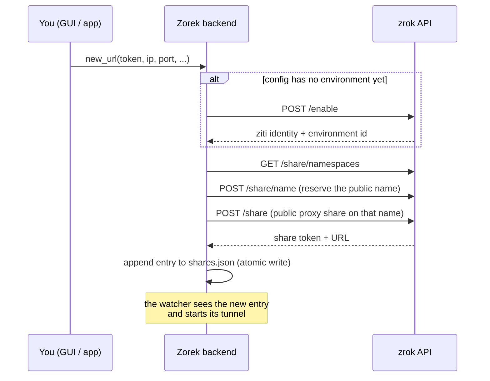

# Creating URLs

*Create URL* turns **an enable token plus a target** into a new public `https://<name>.shares.zrok.io` address that
forwards to your `ip:port`, and adds it to the config so it is served immediately.

## The enable token

The enable token (zrok calls it the *account token*) identifies your zrok account. Get it from the zrok web console
after signing in at the zrok service you use. Treat it like a password: with it anyone can create shares in your
account. Zorek stores it, in plain text, as `enable_token` in `shares.json` so that you only type it once; see
[Security](security.md).

!!! info "Which zrok service?"
    Zorek talks to `https://api-v2.zrok.io` (the hosted zrok v2 service). To use a self-hosted instance set the
    environment variable `ZROK2_API_ENDPOINT` before starting the app (PC only).

## Fields

| Field | Meaning |
|-------|---------|
| Enable token | Your account token. Leave empty to reuse the one saved in the config (or the `ZROK2_ENABLE_TOKEN` environment variable). |
| Target IP | Address the tunnel connects to, as seen from the device running Zorek. `127.0.0.1` for a server on the same machine; `10.0.2.2` is the PC from inside the Android emulator. |
| Port | TCP port of the target. |
| Name (optional) | The public name: `<name>.shares.zrok.io`. Leave empty for a random `zorek<8 hex>`. Names are global on the zrok service: if it is taken you get an error and nothing is created. |
| Scheme / *target speaks https* | `http` (default) or `https`. With `https` Zorek wraps the connection to the target in TLS and does not verify its certificate. |

## What happens when you press the button



1. **Environment.** If an entry (or the top level) of the config already holds an `identity` and `env_zid`, that
   zrok environment is **reused**. Otherwise Zorek calls *enable* once, which registers this device as a new
   environment in your account, and stores the returned ziti identity in the new entry. The following URLs reuse it, so
   you do not get one environment per URL.
2. **Name and share.** The name is reserved, then a *public proxy* share is created on it. The share is created in the
   environment from step 1; that is why the entry must carry that environment's identity, and why only that
   environment can serve it.
3. **Config.** The entry is appended with the URL, share token, target and identity, and `enable_token` is saved.
   Writes are atomic (temp file + rename), so the watcher never reads half a file.

The tunnel starts on the next 2-second tick, so the URL works a few seconds after the confirmation.

## Limits and what Zorek does not do

- **No deletion.** Removing an entry from the config stops the tunnel but leaves the share and the name in your zrok
  account. Delete them in the zrok web console or with the zrok CLI (`zrok2 delete name`, `zrok2 unshare`).
- **No authentication on the URL.** Shares are created with `authScheme: none`: anyone with the URL reaches your
  target. Put authentication in the target service, or see [Security](security.md).
- **One name per share**, in the first namespace the service offers (`shares.zrok.io`).
- Account limits (number of environments/shares) are enforced by zrok; the error text is shown verbatim. HTTP `429`
  means you are creating things too fast, wait and retry.

## Doing the same from a script

```python
import sys; sys.path.insert(0, "backend")
from zorek_backend import new_url

entry = new_url("shares.json", "ENABLE_TOKEN", "192.168.1.20", 80, "http", name="my-nas")
print(entry["public_url"])
```
