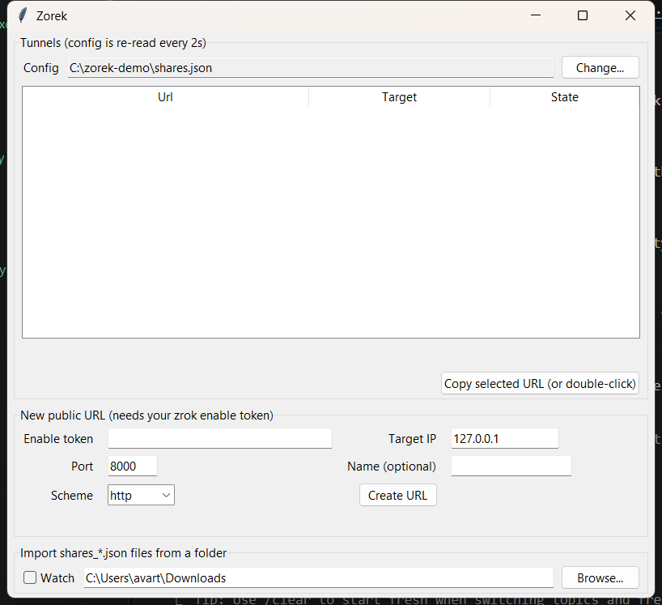
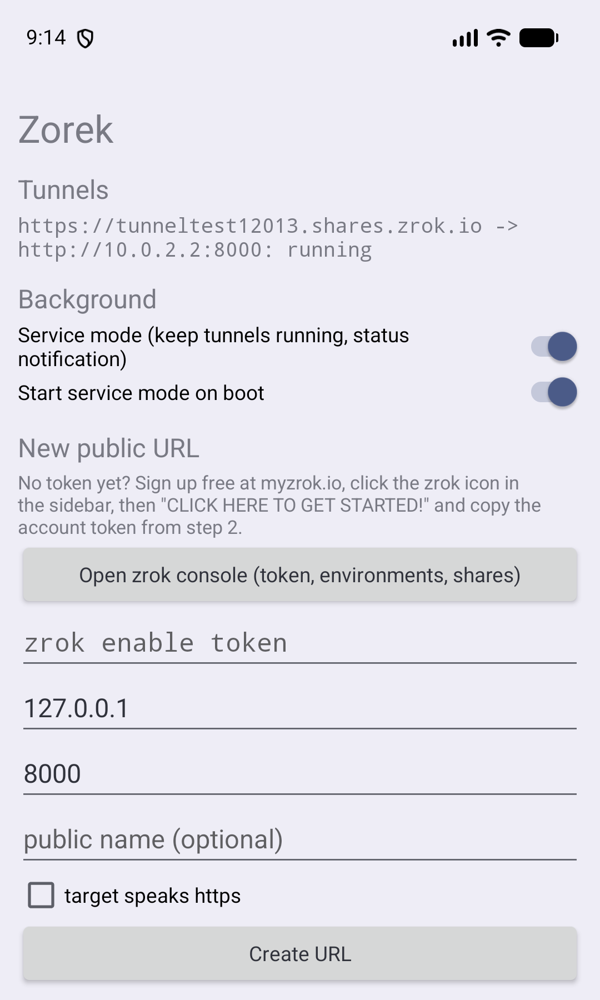

# Get a zrok account and your enable token

Zorek needs one secret from you: the **account token** of your zrok account (zrok calls it the *enable token*). It lets
Zorek register itself as a device (an *environment*) and create public URLs in your account. This page shows how to get
it, how to see what Zorek created, and what the free service allows.

## 1. Create a free account

1. Open [myzrok.io](https://myzrok.io) and sign up for a free account. You do not need to deploy anything yourself:
   the hosted service at `zrok.io` is run for you.
2. Confirm your e-mail address and sign in.

!!! note "zrok2"
    Zorek talks to the **zrok2** API at `https://api-v2.zrok.io`. The account you create at myzrok.io works for it.

## 2. Find your enable token

1. After signing in, click the **zrok** icon in the left sidebar. This opens the zrok **API console**
   (<https://api-v2.zrok.io/>).
2. Click the green **CLICK HERE TO GET STARTED!** button. A getting-started wizard opens.
3. Under **step 2** of the wizard, copy the account token. It is a short alphanumeric string, for example
   `7g3K6gVKikWb`.

!!! warning "Treat the token like a password"
    Anyone who has it can create and delete shares in your account. Do not paste it into chats, issues or screenshots.
    If it leaks, rotate it in the console. Zorek keeps it in plain text in `shares.json`; see [Security](security.md).

The Android app has an **Open zrok console** button above the token field that opens the console in your browser, and
a short reminder of these steps.

## 3. Give the token to Zorek

=== "PC app"

    Paste it into **Enable token**, set the target (for example `127.0.0.1` / `8000`) and press **Create URL**.

    { width=520 }

=== "Android app"

    Paste it into the **zrok enable token** field in *New public URL*, fill target IP and port, press **Create URL**.

    { width=300 }

=== "Environment variable"

    Set `ZROK2_ENABLE_TOKEN` for your user and leave the token field empty. Zorek uses it when the config has no saved
    token.

You only type the token once: Zorek saves it as `enable_token` in `shares.json`. More in [Creating URLs](creating-urls.md).

## See your active shares

There are three places, from most to least convenient.

| Where | What you see |
|-------|--------------|
| **Zorek itself** | The *Tunnels* list (PC table, Android status and notification): every share Zorek serves, its public URL, its target and its state (`running`, `connecting`, or the last error). |
| **The zrok console** (<https://api-v2.zrok.io/>) | Your environments and the shares in them, drawn as a graph in the explorer. Click an environment node and its details appear in the panel at the bottom. Zorek creates one environment per device that enabled it, named after the user and host. |
| **The zrok CLI** (optional) | `zrok2 status` shows whether this machine is enabled (`Account Token <<SET>>`, `EnvZId <<SET>>`); the CLI can also list and delete shares and names. |

!!! tip "Delete what you no longer need"
    Removing an entry from Zorek stops its tunnel but does **not** delete the share or the reserved name from your
    account. Delete them in the console or with the CLI, otherwise they keep counting against your limits.

## What the free service allows

The default public service (`zrok.io`) is shared by many users and has limits per account:

- **Bandwidth: about 5 GB per day** on the free plan. The window is a *rolling 24 hours*, not a calendar day. When you
  exceed it, **your running shares are disabled and new shares cannot be created** until the traffic of the last 24
  hours falls back under the limit. Tunnels in Zorek then show errors; they recover by themselves once zrok lifts the
  block.
- **Number of shares and environments** depends on your plan; see the [zrok pricing](https://zrok.io/pricing/) page for
  the current numbers.
- **Request rate** protects the service: about 2,000 requests per 5 minutes per visitor IP address and 7,500 requests
  per 5 minutes per share. Above that visitors get an error for a while.

!!! info "What does this mean in practice?"
    5 GB a day is plenty for a small web page, an API, a webhook receiver or a dashboard. It is **not** meant for
    streaming video, large downloads or file mirrors: a few movies would use the whole day. If you need more, upgrade
    the plan or [run your own zrok](https://docs.zrok.io); then set `ZROK2_API_ENDPOINT` (PC) to your instance.

The numbers above come from the zrok service documentation and the plan you chose; the authoritative, current values are
on the pricing page, because they can change.
