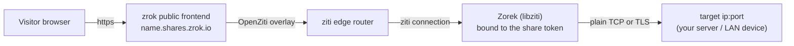
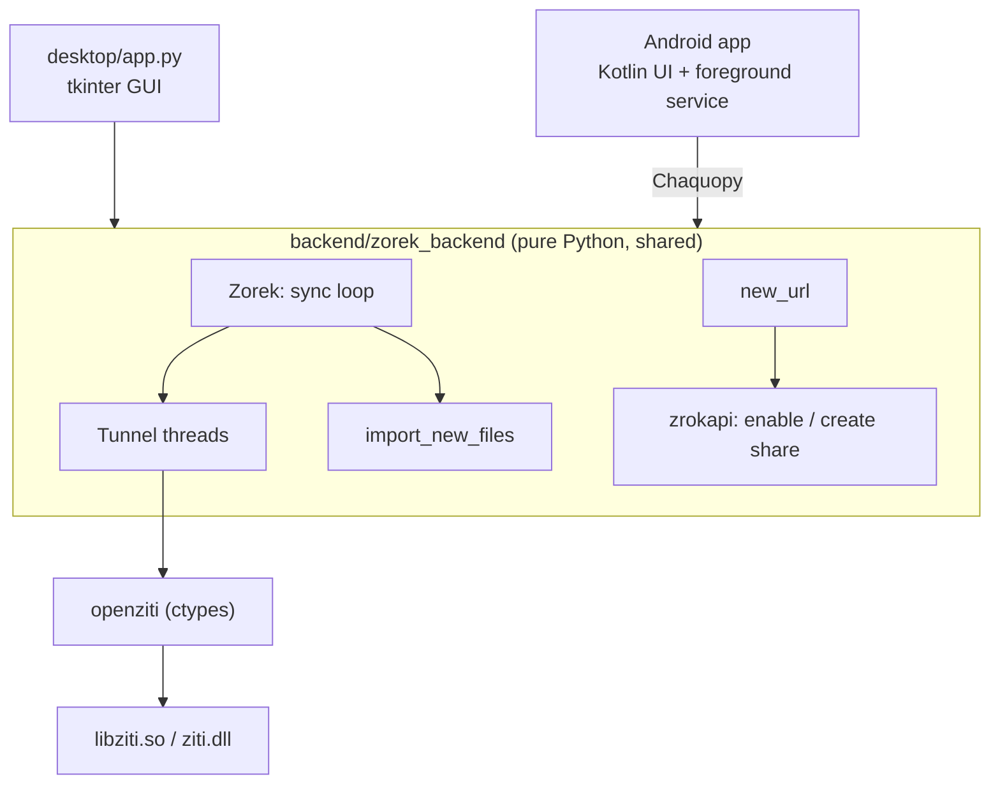
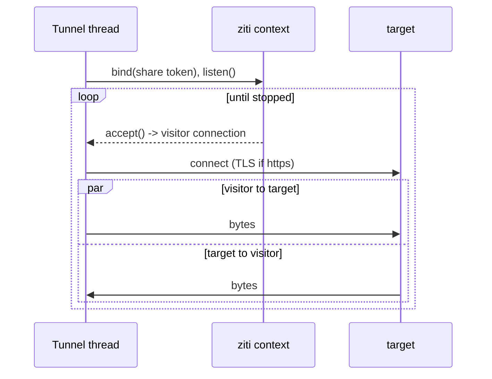

# How it works

## The big picture

- A **zrok share** is a named service on the [OpenZiti](https://openziti.io) overlay network. The public frontend
  terminates the visitor's HTTPS connection and forwards the request into the overlay.
- Nobody opens an inbound port on your side. Instead, Zorek makes an **outbound** connection to the overlay and
  **binds** the share: it tells ziti "I am the one serving this share token". That is why it works behind NAT and
  firewalls, on a phone, and with devices that cannot run zrok themselves.
- Each visitor connection arrives at Zorek as a ziti connection. Zorek opens a TCP connection to `tunnel_ip:tunnel_port`
  (wrapped in TLS for `tunnel_scheme: https`) and copies bytes in both directions until either side closes.

Zorek does **not** parse HTTP; it forwards raw bytes, so it works for any protocol the frontend passes through
(including WebSockets).

## Vocabulary

| Term | What it is |
|------|------------|
| Account / enable token | Your zrok account and its secret token. Used only to call the zrok API (enable, create share). |
| Environment | A registered device in your account, created by *enable*. Has a ziti **identity** (certificate + private key). |
| Share | A public endpoint created in one environment. Identified by its **share token** (`public_token`). |
| Name | The `<name>` in `<name>.shares.zrok.io`, reserved in a namespace and attached to a share. |
| Bind | Serving a share: only the environment that created a share can bind it. |

## Components

| Module | Responsibility |
|--------|----------------|
| `core.Zorek` | The sync loop and status. Owns one `Tunnel` per share. |
| `core.Tunnel` | One daemon thread: bind, accept, connect to the target, pump bytes. |
| `core.import_new_files` | Merges `shares_*.json` from a folder into the config. |
| `core.new_url` | The *Create URL* logic. |
| `zrokapi` | Three HTTP calls to the zrok API with `urllib`. |
| `desktop/app.py` | The PC window. A thin layer: it only calls the backend and renders `status()`. |
| Android `MainActivity` / `TunnelService` | UI and the foreground service that starts the backend. |

## The sync loop

`Zorek.run_forever()` calls `sync()` every 2 seconds. One pass:

1. If a folder watch is on, import new `shares_*.json` files into the config.
2. Read the config. If it is invalid, record the error and **stop here** (running tunnels are untouched).
3. Compare the wanted shares (by `public_token`) with the running tunnels:
    - tunnel without an entry: **stop** it;
    - entry whose target or identity changed: **restart** it;
    - entry whose tunnel thread died: **restart** it, but not more often than every 10 seconds;
    - entry without a tunnel: **start** it.
4. `status()` then reports, per tunnel, its URL, target and `running` / the last error.

There is no file-system watcher: re-reading a small file every 2 seconds is simpler and behaves identically on
Windows, Linux and Android (including files written by other apps).

## A tunnel

- If the target cannot be reached, the visitor connection is closed and the error (`cannot reach 10.0.0.5:80: ...`) is
  recorded; the tunnel keeps listening, so it recovers by itself when the target comes back.
- Any other exception ends the thread; the sync loop restarts it (see above).
- On Android, libziti's listening socket is **non-blocking**: `accept()` raises `BlockingIOError` when nobody is
  connecting. The tunnel sleeps 50 ms and retries, and switches every accepted connection to blocking mode so the byte
  pumps do not see spurious `EAGAIN`. On Windows/Linux `accept()` simply blocks.

## Identities

Every distinct ziti identity gets one ziti context (one overlay connection), shared by all its tunnels. Identities that
come from the config are written to `~/.zrok2/identities/zorek-<sha1 prefix>.json` before use. See
[identity resolution](config.md#identity-resolution).

## Android specifics

- **Python**: [Chaquopy](https://chaquo.com/chaquopy/) 16.1.0 embeds CPython 3.11. The backend directory and the
  vendored `openziti` package are added as Python sources of the app.
- **Native**: `libziti.so` (ziti-sdk-c 1.18.3) is built with the NDK for three ABIs and packaged as a JNI library, so
  `ctypes` can `dlopen("libziti.so")` by name. The vendored `openziti` has one patch for that.
- **Process**: `TunnelService` is a foreground service. On start it calls `zorek_backend.start(config, home,
  import_dir)`, which sets `HOME` to the app's files directory (so `~/.zrok2` is app-private), creates the `Zorek` object
  and starts `run_forever()` in a thread.
- **UI**: the activity polls `zorek_backend.status()` every 2 seconds and calls `create_url()` on a worker thread.

## What is stored where

| Data | Location |
|------|----------|
| Config (shares, token, identities) | `shares.json` (PC: your path; Android: `files/shares.json`) |
| Imported-files ledger | `shares.json.imported` next to the config |
| Materialised identities | `~/.zrok2/identities/zorek-*.json` (Android: inside `files/`) |
| zrok CLI environment (optional, PC) | `~/.zrok2/environment.json` and `identities/environment.json`, owned by the zrok CLI, only read |
| Switch state (Android) | app preferences, `watch_downloads` |
