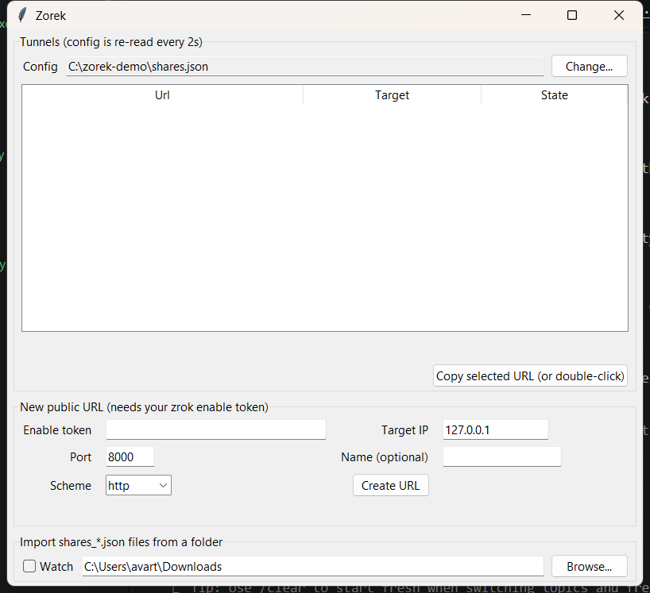

# PC app

Windows and Linux. A small tkinter window (no extra GUI dependencies; tkinter ships with Python).

## Install and run

=== "From source"

    ```
    pip install openziti
    python desktop/app.py                 # uses ./shares.json (created on first "Create URL")
    python desktop/app.py C:\zorek\home.json
    ```

=== "Prebuilt binary"

    Download `zorek-windows-x64.exe` or `zorek-linux-x64` from the
    [releases page](https://github.com/mon231/com.rel.zorek/releases) and run it. It is a single file with Python
    and `libziti` inside; it opens the same window.

    The Windows build is a GUI program (no console). For console output run from source with `--nogui`.

=== "Headless"

    ```
    python desktop/app.py --nogui shares.json
    ```

    Prints the status dictionary whenever it changes. Stop with Ctrl+C.

## The window

{ width=560 }

```
+------------------------------------------------------------+
| Tunnels (config is re-read every 2s)                       |
|  Config [C:\zorek\shares.json                ] [Change...] |
|  +-- Url --------------+-- Target ----------+- State -----+ |
|  | https://a.shares... | http://127.0.0.1:8000 | running  | |
|  | https://b.shares... | https://10.0.0.5:18972| running  | |
|  +---------------------+-----------------------+----------+ |
|  [Copy selected URL (or double-click)]                     |
+------------------------------------------------------------+
| New public URL (needs your zrok enable token)              |
|  Enable token [*****]   Target IP [127.0.0.1]              |
|  Port [8000]            Name (optional) [        ]         |
|  Scheme [http v]                          [Create URL]     |
+------------------------------------------------------------+
| Import shares_*.json files from a folder                   |
|  [x] Watch  [C:\Users\me\Downloads        ] [Browse...]    |
+------------------------------------------------------------+
```

- **Tunnels** lists every share in the config with its state. Double-click a row to copy its URL. Errors from
  the config or from a tunnel appear in red under the table.
- **Config / Change...** switches to another `shares.json` (or creates one).
- **New public URL** creates a share; see [Creating URLs](creating-urls.md). The enable token is masked and remembered
  in the config file.
- **Import** turns on the folder watch described in [Importing shares files](importing.md). Default folder: your
  `Downloads`.

## Using the zrok CLI environment

If this PC already has a zrok environment (`zrok2 enable` was run, `~/.zrok2/identities/environment.json` exists) and
you point Zorek at a plain list of shares created from it, no `identity` is needed in the config: the CLI's identity is
used. See [identity resolution](config.md#identity-resolution).

## Running at login

Zorek has no installer or autostart of its own. Use your OS: a shortcut in the Windows *Startup* folder, a Task
Scheduler "at log on" task, or a systemd user unit, pointing to the binary and the config path.
